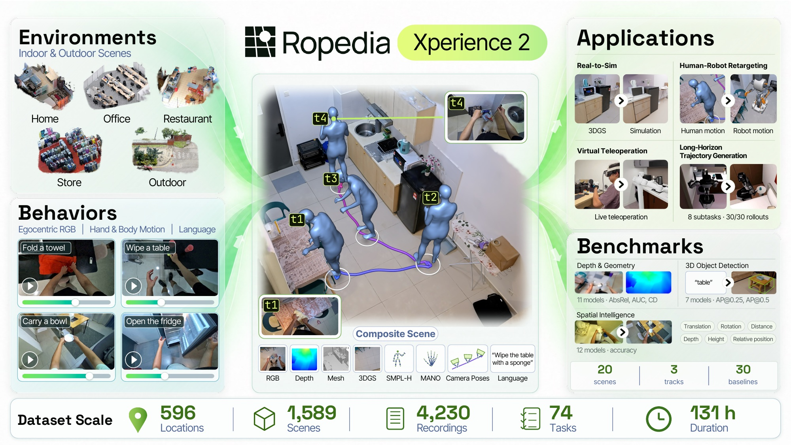
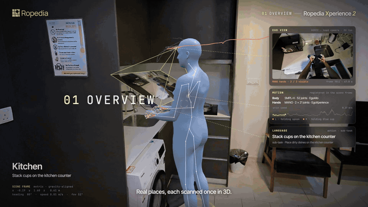
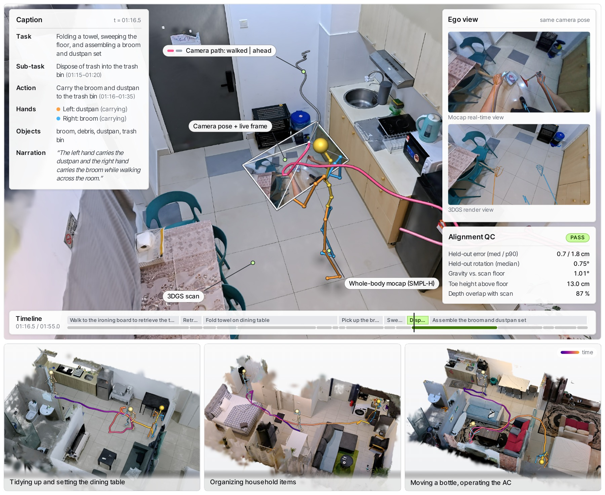

<div align="center">

# Ropedia Xperience 2

### A Gold Standard for Scaling Physical AI Environments and Behaviors

**Ropedia Research Team**

<p>
  <a href="https://ropedia.com/xperience/2-research/"></a>
  <a href="https://huggingface.co/datasets/ropedia-ai/Ropedia-Xperience-2"></a>
  <a href="https://pub-a5d54d8bd1a5427c92ce334fabec455e.r2.dev/github/v37-20261112/xperience-2-demo.mp4"></a>
  
</p>

**Metric 3D environments and human behaviors, connected in one scene.**

</div>

[](https://ropedia.com/xperience/2-research/)

<p align="center">
  <b>1,500+ scene scans · 4,000+ recordings · 74 tasks · 131 hours</b><br>
  <sub>Scans: released set. Recordings, tasks and hours: collection inventory.</sub>
</p>

## Demo

<a href="https://pub-a5d54d8bd1a5427c92ce334fabec455e.r2.dev/github/v37-20261112/xperience-2-demo.mp4">
  
</a>

<p align="center">
  <a href="https://pub-a5d54d8bd1a5427c92ce334fabec455e.r2.dev/github/v37-20261112/xperience-2-demo.mp4"><b>▶ Watch the full demo · 3:16</b></a>
  &nbsp; · &nbsp;
  <a href="https://ropedia.com/xperience/2-research/">Explore the interactive project page</a>
</p>

## Scene registration

[](docs/scene_registration.md)

Align a processed **HOMIE recording → KOSMO scene** and export trajectories and estimated hand/body motion in the scene frame.

```bash
pip install -e .
xperience-register --kosmo /path/to/scene --homie /path/to/recording --out results/take
```

Python 3.10–3.12 · [Installation & inputs](docs/scene_registration.md#installation) · [Outputs & quality checks](docs/scene_registration.md#outputs-and-coordinates) · [Synthetic example](examples/fit_synthetic_trajectory.py)

<details>
<summary><b>Citation</b></summary>

```bibtex
@misc{ropedia2026xperience2,
  title  = {Ropedia Xperience 2: A Gold Standard for Scaling Physical AI Environments and Behaviors},
  author = {{Ropedia Research Team}},
  year   = {2026},
  url    = {https://ropedia.com/xperience/2-research/}
}
```

</details>

Code: [Apache-2.0](LICENSE) · Data: [access and usage terms](https://huggingface.co/datasets/ropedia-ai/Ropedia-Xperience-2)
